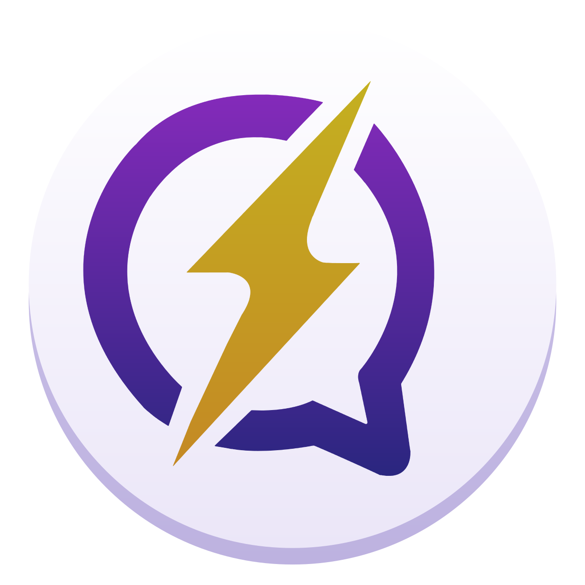
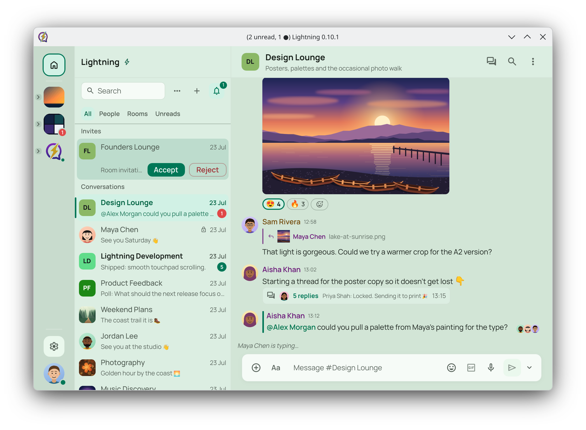
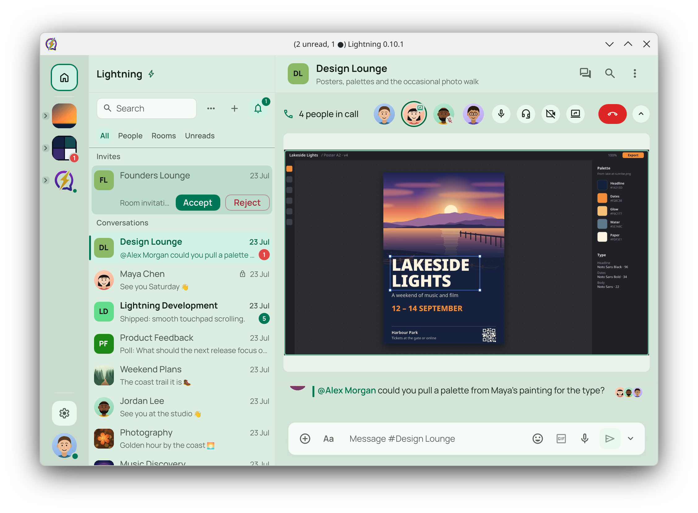
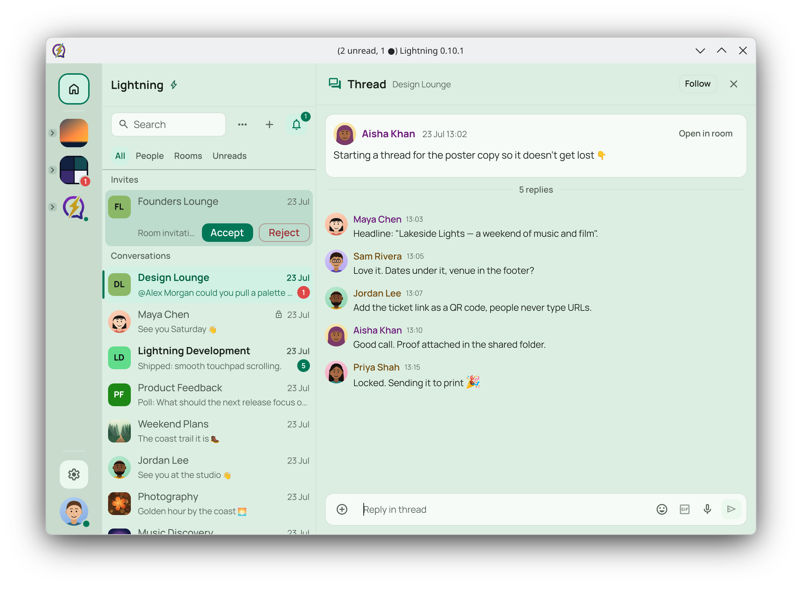
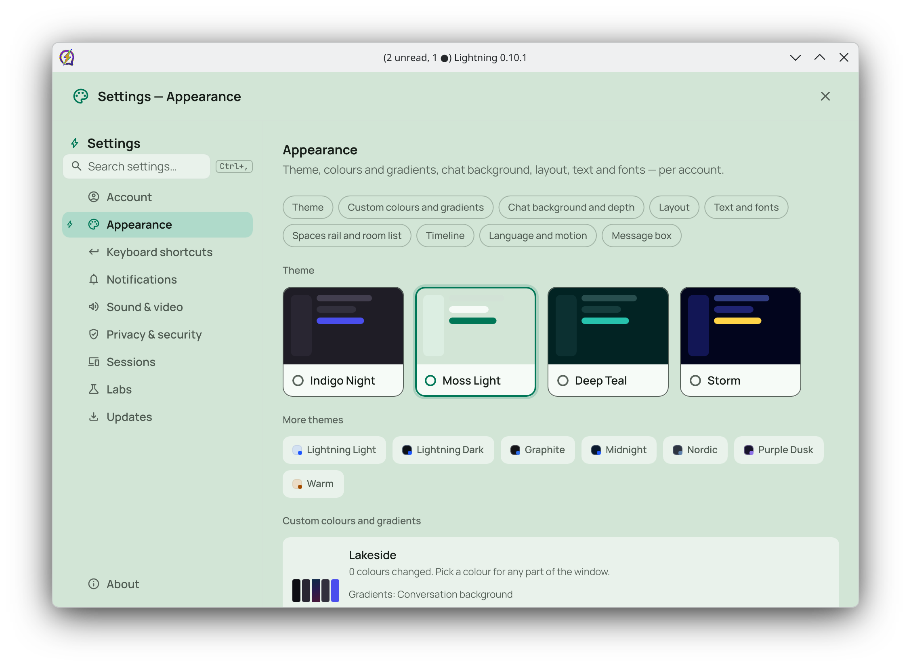

<div align="center">



# Lightning

**A native Matrix client for the desktop. Qt 6, not Electron.**<br>
Built on the official Rust Matrix SDK, with search that works in encrypted
rooms and MatrixRTC group calls.

[](https://github.com/Mizerd/lightning/releases/latest)
[](https://flathub.org/apps/org.lightning_matrix.Lightning)
[](LICENSE)
[](https://github.com/Mizerd/lightning/stargazers)
[](https://matrix.to/#/%23lightning%3Amatrix.smetonis.net)

**[Website](https://www.lightning-matrix.org)** ·
**[Get it on Flathub](https://flathub.org/apps/org.lightning_matrix.Lightning)** ·
**[All downloads](https://github.com/Mizerd/lightning/releases/latest)** ·
**[Install guide](docs/install.md)**

<a href="https://flathub.org/apps/org.lightning_matrix.Lightning"></a>



<table>
  <tr>
    <td></td>
    <td></td>
    <td></td>
  </tr>
  <tr>
    <td align="center">Group calls</td>
    <td align="center">Threads</td>
    <td align="center">Themes</td>
  </tr>
</table>

</div>

> **Beta.** Lightning is usable day to day but young, and is listed as Beta in
> the [Matrix client directory](https://matrix.org/ecosystem/clients/lightning/).
> Expect rough edges, and please [report them](https://github.com/Mizerd/lightning/issues).

## Why Lightning

- **Actually native.** Qt 6 / QML with C++ for the app. No Electron, no web
  view, not a fork of another client.
- **The official SDK does the Matrix part.** Sync, timelines, threads, media
  and end-to-end encryption come from `matrix-rust-sdk`. Lightning implements
  no cryptography of its own.
- **Search that covers encrypted rooms.** A local index on your computer, since
  a server cannot search ciphertext. The catch: message content is stored
  unencrypted on disk (see [Security and privacy](#security-and-privacy)).
- **Group calls.** MatrixRTC audio, camera and screen sharing, tested against
  Element Call, Sable and Lightning on Linux and Windows. Not tested on macOS.
- **Linux first, also Windows and macOS.** Flatpak, AppImage, deb, rpm, snap,
  a Nix flake, and Windows and macOS builds. Windows and macOS packages are
  unsigned.
- **No telemetry.** No analytics or crash reporting. Lightning has not been
  formally security audited.
- **Free software.** GPL-3.0-or-later.

If Lightning is useful to you, a star on GitHub helps other people find it.
Bug reports and patches help more: see [Contributing](#contributing).

Lightning is a [Matrix](https://matrix.org/) client for Linux, Windows and
macOS. The interface is Qt 6 / QML with C++ for the application layer, and the
official [`matrix-rust-sdk`](https://github.com/matrix-org/matrix-rust-sdk)
does synchronisation, timelines, end-to-end encryption, threads and media.

## Features

- **Messaging:** replies, edits, reactions, mentions, read receipts, pinned
  messages, polls, drafts, and forwarding to several rooms at once.
- **Threads:** real Matrix threads in a side panel, encrypted rooms included.
- **Encryption:** handled by the SDK. Cross-signing, emoji and QR verification,
  key backup restore, and messages that decrypt in place when a key arrives.
- **Search:** a local index on your computer, so encrypted rooms are
  searchable too; server search where the server can read the room.
- **Calls:** MatrixRTC group calls with audio, camera and screen sharing that
  work with Element Call. Not yet tested on macOS.
- **Spaces:** a single activity-ordered list, or a Spaces rail with nested
  subspaces, drag-to-reorder and local folders.
- **Accounts:** password or browser (OAuth 2.0 / OIDC) sign-in, several
  accounts on different homeservers, and signing your other devices in from
  this one with a code.
- **Media:** inline images, video, audio and voice messages; stickers, custom
  emoji and a GIF picker (GIPHY or KLIPY) that sends only your search term.
- **Desktop:** eleven themes and a theme editor that checks contrast, eleven
  languages including Arabic, native notifications (with reply where
  supported), tray, Ctrl+K switcher and rebindable shortcuts.
- **Updates:** checks for new releases and installs them where the package
  format allows, verified against a signed manifest.

The full tour, more screenshots and the known limits are in
[docs/features.md](docs/features.md).

[Message keyboard navigation](docs/message-keyboard-navigation.md)
covers compose focus, message selection, independent paging, Activity
and quick-switcher selection/dismissal, and cursor blinking preferences,
with a configuration-file example.

## Install

On Linux, [Flathub](https://flathub.org/apps/org.lightning_matrix.Lightning) is the easiest route. The Flatpak brings its own Qt,
GStreamer and C library, so it also runs on distributions too old for the deb,
the rpm and the AppImage.

Every release also ships these on
[GitHub Releases](https://github.com/Mizerd/lightning/releases/latest),
with a `SHA256SUMS` file:

| Platform | Packages |
|---|---|
| Linux (x86-64) | AppImage, `.deb` for Debian 13+ or Ubuntu 26.04+, `.rpm` for Fedora 44+, `.flatpak`, `.snap` |
| NixOS | `nix run github:Mizerd/lightning`, or the flake with its Home Manager module |
| Windows 10+ (x86-64) | MSI, Setup EXE or portable ZIP, per-user by default. Unsigned, so SmartScreen warns |
| macOS 26+ (Apple Silicon) | ZIP. Not notarized, so the first launch needs *Open Anyway*. Does not update itself |

[docs/install.md](docs/install.md) has the commands, which distributions each
package is known to work on, the NixOS flake, all-users installs on Windows and
the macOS first-launch steps.

## Build from source

With the repository's Nix flake on Linux:

```sh
git clone https://github.com/Mizerd/lightning.git
cd lightning
nix develop -c cmake -S . -B build-rust -G Ninja -DENABLE_RUST_SDK_BACKEND=ON
nix develop -c cmake --build build-rust
scripts/run-dev.sh
```

[docs/building.md](docs/building.md) covers the mock-backend tree, the tests,
build options and how the layers fit together.

## Contributing

Bug reports, testing and focused patches are welcome. Read
[CONTRIBUTING.md](CONTRIBUTING.md) first.

- The public repository is <https://github.com/Mizerd/lightning>. A change
  arrives as a pull request there or as a patch emailed to the maintainer.
- A pull request is applied on the maintainer's own repository, which GitHub
  is synchronised from, and then closed, not merged, even when it ships. The
  [issue tracker](https://github.com/Mizerd/lightning/issues) is the place to
  report a bug.
- Credit: your commits keep your name and email whichever route you use, and
  you appear in the contributor list. Details in
  [CONTRIBUTING.md](CONTRIBUTING.md).
- Mirrors: GitHub is the public home and the place for issues and pull
  requests. Release packages are also mirrored to
  [gitlab.com/lightning-matrix/lightning](https://gitlab.com/lightning-matrix/lightning)
  as a last-resort download source. It is not a separate project.
- Chat: [#lightning:matrix.smetonis.net](https://matrix.to/#/%23lightning%3Amatrix.smetonis.net).
  Website: <https://www.lightning-matrix.org>.

## Security and privacy

End-to-end encryption is handled entirely by the Rust Matrix SDK. Lightning
collects nothing: no analytics, telemetry or crash reporting. Besides your
homeserver it contacts the release host for an anonymous update check (on by
default, sending only `Lightning/<version>`) and the GitHub mirror when you
install an update, a GIF provider only while the GIF picker is open, and a
linked site only for a link preview you ask for.

Message content, from encrypted rooms too, is stored **unencrypted** on disk
in your account's store directory, readable only by your user account;
full-disk encryption is what protects it at rest. Lightning has **not** been
formally security audited.

- [Privacy policy](docs/privacy.md): every network path, what is sent, and how
  to turn it off
- [Application updates](docs/updates.md): how an update is verified
- [Code signing policy](docs/code-signing-policy.md): Windows and macOS
  packages are unsigned today; the Ed25519-signed update manifest is the
  integrity check on every platform
- [Third-party notices](docs/third-party-notices.md): what ships inside a
  release, and under which licence
- [Threat model](docs/threat-model.md) and the
  [security rules for contributors](CONTRIBUTING.md#security-sensitive-areas)

## Licence

Copyright © 2026 Rokas Smetonis. Lightning is free software licensed under the GNU
General Public License v3.0 **or later** — see [LICENSE](LICENSE).

**Maintainer:** Rokas Smetonis — [antrasrokas@gmail.com](mailto:antrasrokas@gmail.com)
